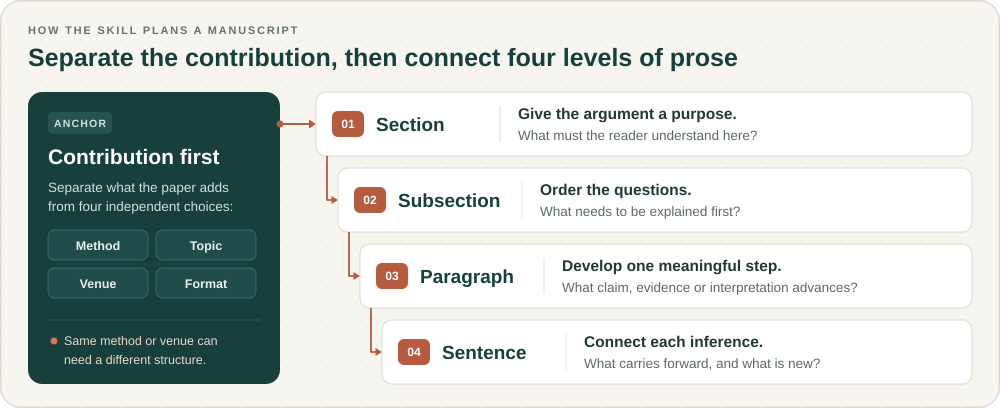

<p align="center">
  
</p>

<h1 align="center">HCI Academic Writing Skills</h1>

<p align="center">
  <strong>Build the argument. Shape the paper. Revise the prose.</strong><br>
  Contribution-aware writing skill for ACM LaTeX manuscripts
</p>

<p align="center">
  <a href="skills/hci-academic-writing/SKILL.md"></a>
  <a href="docs/COMPATIBILITY.md"></a>
  <a href="LICENSE"></a>
</p>

<p align="center">
  <a href="README.ko.md">한국어</a> · <a href="#quick-start">Quick start</a> · <a href="#the-structure-follows-the-contribution">Structure</a> · <a href="#try-it-on-your-manuscript">Examples</a> · <a href="#what-the-guidance-is-based-on">Evidence</a>
</p>

<p align="center">
  
</p>

<p align="center"><sub>CHI · CSCW · UIST · DIS · IUI &nbsp;/&nbsp; Systems · Empirical · Sociotechnical · RtD · Concepts · Reviews</sub></p>

Guides AI coding agents—Codex, Claude Code and Antigravity—to work inside your manuscript folder and edit the actual `.tex` files you will upload to Overleaf. You supply the research materials, draft and task; the skill loads only the writing references needed ([tested scope for each host](docs/COMPATIBILITY.md)).

---

## What this skill helps you do

- **Frame** — Clarify the paper's knowledge claim, supporting evidence and boundaries; plan section purposes, subsection order, paragraph roles and logical transitions.
- **Draft** — Turn study notes into grounded manuscript text with missing facts left explicit (`% HCI-TODO[evidence]: ...`); reorganize related work around the unresolved problem and relationships among prior approaches rather than a list of papers.
- **Revise** — Repair paragraph order, sentence connections and referents; cut passages to a word limit while retaining consequential claims, evidence and uncertainty; tie review responses to evidence and concrete manuscript changes.

The deliverable is usually a direct edit to your manuscript, accompanied by a short explanation of what changed. A small wording task stays small; it does not require a full-paper planning exercise.

## Quick start

Requires an existing manuscript folder, a supported AI coding agent and **Python 3.9+** for the installer (no third-party Python packages). This repository provides the skill bundle; your agent supplies the model and editing tools.

### 1. Get the repository

```sh
git clone https://github.com/Soohwan-Lee/HCI-Academic-Writing-Skills.git
cd HCI-Academic-Writing-Skills
```

### 2. Install into your manuscript folder

Replace `/path/to/paper` with the folder containing your ACM project and select your host:

```sh
# Preview a Codex installation; writes nothing.
python3 scripts/install_skill.py --host codex --scope project --project-root /path/to/paper

# Install for Codex.
python3 scripts/install_skill.py --host codex --scope project --project-root /path/to/paper --apply

# Or install for Claude Code.
python3 scripts/install_skill.py --host claude-code --scope project --project-root /path/to/paper --apply
```

- **Antigravity and paths:** Use `--host antigravity-app`, `antigravity-ide` or `antigravity-cli`. Codex and Antigravity project installs write to `.agents/skills/hci-academic-writing/`; Claude Code writes to `.claude/skills/hci-academic-writing/`.
- **Safe updates:** Without `--apply`, the installer previews changes and refuses conflicting files. Move any older copy outside directories scanned for skills before reinstalling—do not keep a renamed backup inside a scanned skill directory. See [installation and compatibility](docs/COMPATIBILITY.md) for personal installs, exact paths and tested behavior.

### 3. Open the paper folder and request the skill

Switch to your manuscript project rather than this skill repository:

```sh
cd /path/to/paper
```

Start a fresh agent session there, name `hci-academic-writing` explicitly, and verify that the agent reads the intended `SKILL.md`. If automatic discovery fails, ask it to read `.claude/skills/hci-academic-writing/SKILL.md` (Claude Code) or `.agents/skills/hci-academic-writing/SKILL.md` (Codex / Antigravity) explicitly and apply those instructions:

> Use hci-academic-writing. The root is main.tex. Read sections/related-work.tex and revise it around the unresolved problem. Preserve existing claims and citation attachments. Improve paragraph order and sentence connections, then edit the file and summarize the changes.

<details>
<summary><strong>Installed folder layout and bundle notes</strong></summary>

Your manuscript keeps its existing layout:

```text
my-paper/
├── main.tex
├── sections/
│   ├── introduction.tex
│   ├── related-work.tex
│   └── ...
├── references.bib
└── .claude/skills/hci-academic-writing/  # or .agents/skills/ for Codex & Antigravity
    ├── SKILL.md
    ├── references/
    └── scripts/
```

The installed bundle is self-contained: you do not need the full research corpus or Zotero library to use it. Compiling requires your TeX toolchain, uploading to Overleaf is a separate step, and the ACM template is not included.

</details>

## The structure follows the contribution

An interview can inform a system, support a sociotechnical interpretation or help develop a concept. Those papers need different arguments even when they use similar methods or target the same venue.

The skill separates **contribution, method, topic, venue and manuscript form**, then plans four connected levels together:

<picture>
  <source media="(max-width: 600px)" srcset="assets/writing-levels-en-mobile.svg">
  
</picture>

Source-backed examples illustrate alternative progressions:

| Kind of argument | One possible progression |
|---|---|
| **New interaction capability** | Capability overview → design rationale → implementation → capability-specific evaluation |
| **System informed by formative inquiry** | Formative findings → design commitments → system → distinct evaluation questions |
| **Reflective design / pictorial** | Situated practice → reflective lens → material or visual cases → cross-case interpretation |
| **Sociotechnical understanding** | Situated accounts → relationships or tensions → conceptual interpretation → implications |
| **Historical inquiry** | Period-specific accounts → cross-period analytical dimensions → implications and methodological reflection |
| **Concept development** | Conceptual lineage → illustrative design → participant interpretations → conceptual account |
| **Dataset or research resource** | Construction → characterization → task-specific utility → reuse conditions |
| **Interpretive literature review** | Selection and analysis → thematic findings → conceptual synthesis → research agenda |

These are conditional choices, not required templates for a venue. The [architecture guide](skills/hci-academic-writing/references/architectures.md) explains when each helps, and the [contribution catalogue](skills/hci-academic-writing/references/contribution-catalogue.md) also covers participatory change, critique, methods, replication and hybrid contributions.

Shared references address abstracts, introductions, related work that positions and supports the contribution, discussion, paragraph development and sentence flow. Topic-first paragraphs help when a claim is immediately intelligible; narrative or delayed interpretation can serve other purposes. An 8,000-word allocation is a planning aid, not a universal HCI convention.

## Try it on your manuscript

Give the agent the root file, edit scope, available evidence and any word limit. Include the venue/track and official requirements when the task concerns submission format.

<details>
<summary><strong>Plan a paper beyond generic headings</strong></summary>

> Use hci-academic-writing. Read main.tex and my study notes. Identify the primary contribution and propose an outline suited to it. For every section, give its purpose and subsection order. For the central section, plan each paragraph's claim, supporting material and handoff to the next paragraph. Explain any consequential alternative structure before editing the outline.

</details>

<details>
<summary><strong>Turn findings into an interpretive discussion</strong></summary>

> Use hci-academic-writing. Draft the discussion in sections/discussion.tex from the supplied interview findings. Explain how the observed relationships extend or complicate the concepts already introduced. Keep participant accounts, our interpretation and proposed implications distinguishable. Do not turn every finding into a system requirement.

</details>

<details>
<summary><strong>Develop a design argument</strong></summary>

> Use hci-academic-writing. Read the design diary and annotated artifact images. Help organize the RtD argument around what making and reflection taught us. Propose subsections and paragraph roles that connect material encounters to design understanding, including tensions and unresolved interpretations.

</details>

<details>
<summary><strong>Write a literature synthesis</strong></summary>

> Use hci-academic-writing. Use my review protocol and extraction table to plan the findings and synthesis sections. Distinguish what the corpus contains from the cross-paper interpretation. Choose a structure suited to the review's actual purpose and procedure; do not assume it is a systematic review.

</details>

<details>
<summary><strong>Revise or compress a passage</strong></summary>

> Use hci-academic-writing. Edit the selected results paragraph in sections/results.tex to at most 150 words. Preserve estimates, uncertainty, any null or nonsignificant findings and analysis units. Keep absence-of-effect evidence distinct from a nonsignificant test. Report the counting convention and any material changes.

</details>

These are example requests, not measured performance claims. The agent should preserve bibliography keys, labels, macros and unrelated edits. Unknown facts belong in explicit draft comments such as `% HCI-TODO[evidence]: ...`, not plausible invented prose.

## What the guidance is based on

The repository contains **128 full-text analytical notes**: CHI 41, CSCW 25, UIST 18, DIS 21 and IUI 21, plus one COMPASS and one Findings of EMNLP paper. Sources include award-recognized work, established research lineages and contrasting forms of inquiry. Award evidence is recorded separately from writing analysis.

Within that collection, **12 deeper structure maps** trace actual section/subsection order and selected complete paragraph sequences, with sentence-level analysis. They connect observed writing choices to conditional drafting guidance. They do not mean that every paragraph of all 128 papers has been mapped.

| Evidence | Where to inspect it |
|---|---|
| **Paper selection, sources and analytical notes** | [Corpus](research/CORPUS.md) · [coverage audit](research/COVERAGE-AUDIT.md) |
| **Hierarchy, paragraph roles and sentence flow** | [Structure maps](research/structure-maps/README.md) |
| **Cross-paper interpretation** | [Synthesis](research/SYNTHESIS.md) · [portable corpus index](skills/hci-academic-writing/references/corpus-index.md) |
| **Quantitative length observations** | [Measurements](research/measurements/README.md): seven body/section examples and 32 selected paragraphs in 14 papers |
| **Decisions and revisions** | [Active plan](docs/STRUCTURE-ANALYSIS-PLAN.md) · [review log](docs/REVIEW-LOG.md) |

This is a purposive teaching collection, with AI-assisted analysis and integration review. It is not a representative sample or independently human-validated coding study. Paragraph lengths and section allocations are not established norms. New papers are added when they resolve a meaningful gap, not to reach a numerical target.

## What has been tested

| Layer | Current evidence |
|---|---|
| **Installation and LaTeX reference/dependency checks** | 18 automated tests; isolated host-specific installation layouts |
| **Claude Code file editing** | Two scoped edits in a multi-file ACM fixture, with explicit skill loading and successful compilation |
| **Codex / Antigravity live editing** | Not yet tested |
| **Automatic skill discovery** | Not established by the restricted Claude test; explicit named requests were tested |
| **Whole-paper architectural writing quality** | Broader contribution-specific writing probes remain to be completed |

The [file-edit report](tests/behavior/README.md) records actual behavior. Other generation trials exposed unsupported claims; the [semantic report](tests/behavior/SEMANTIC-REPORT.md) records failures and revisions. Review the agent's changes as an author. No controlled study establishes publication benefits or overall writing-quality gains.

## Development priorities

The skill is usable now, with continuing work on depth and validation:

1. Compare more **within-family alternatives**, especially RtD, empirical organization and review structures.
2. Test outline selection, section drafting and paragraph restructuring in multi-file ACM projects.
3. Expand comparable length measurements before drawing stronger quantitative guidance.
4. Verify ordinary-session discovery and editing across hosts.

The [active plan](docs/STRUCTURE-ANALYSIS-PLAN.md) tracks these gates. Expanding from 128 to 200 papers is not a completion requirement.

## Contribute and reuse

Corrections, contrasting exemplars and real authoring failure cases are welcome. See [contribution guidelines](CONTRIBUTING.md).

Original project code and writing are [MIT licensed](LICENSE); linked papers retain their own rights. Source PDFs, private Zotero records and model transcripts are not distributed. [Visual provenance](assets/README.md) documents the cover, logo and diagrams.

To run local checks:

```sh
python3 -m unittest discover -s tests/install -v
python3 -m unittest discover -s tests/latex-audit -v
python3 scripts/build_corpus_index.py --check
```
